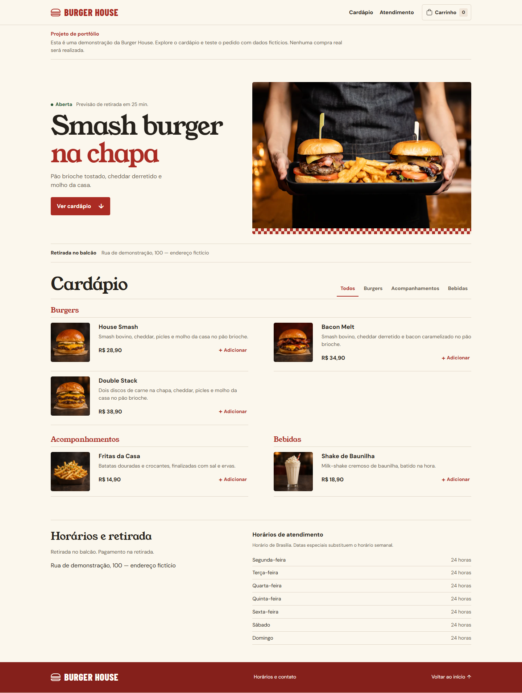
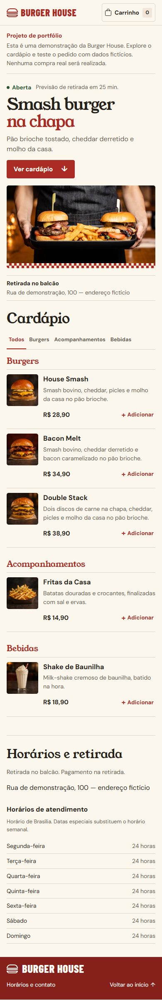
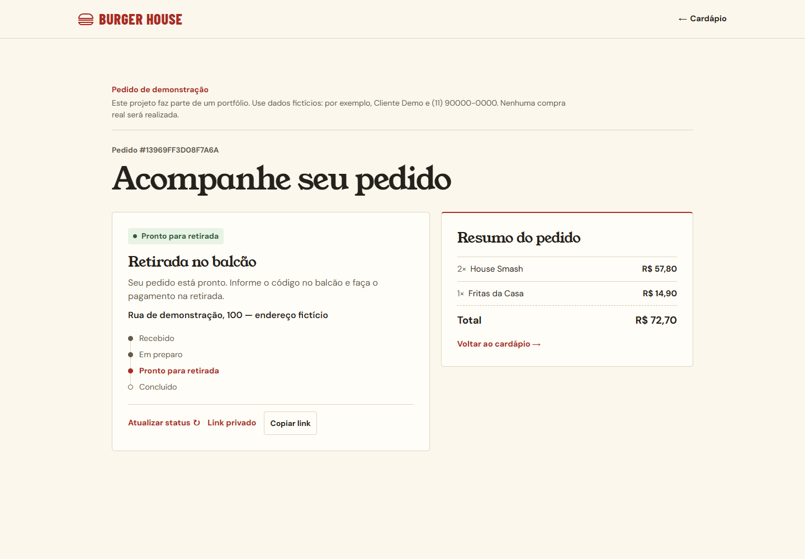

# Burger House

Aplicação PHP/MySQL para hamburgueria: cardápio responsivo, carrinho, checkout, painel da equipe, cozinha e acompanhamento do pedido. O fluxo é **retirada no balcão com pagamento presencial**. Não há entrega ou pagamento online.



<details><summary>Visualização no celular</summary>



</details>

<details><summary>Acompanhamento do pedido de demonstração</summary>



</details>

## Executar com Docker

Requisitos: Docker Engine com Compose. A imagem contém FrankenPHP, PHP 8.4 e `pdo_mysql`; o Compose fornece MySQL 8.4 com volume persistente.

```powershell
Copy-Item .env.example .env
docker compose up --build -d
```

No Bash, use `cp .env.example .env`. Abra [a loja](http://localhost:8080) e [o painel](http://localhost:8080/admin/). O serviço `migrate` aplica o banco antes de iniciar `web`; consulte erros com `docker compose logs migrate web`. O Compose destina-se ao desenvolvimento local, com HTTP e senhas de exemplo. O volume `mysql-data` preserva os dados quando os containers são recriados.

A primeira instalação começa **pausada e sem endereço**. Configure acesso administrativo, endereço, horários, produtos e preços antes de receber pedidos. `APP_DEMO=1` identifica a apresentação como demonstração; o checkout depende das configurações reais da loja.

Para criar a senha administrativa no PowerShell:

```powershell
$secret = Read-Host 'Senha do painel' -AsSecureString
[System.Net.NetworkCredential]::new('', $secret).Password | php -r 'echo password_hash(rtrim(fgets(STDIN)), PASSWORD_DEFAULT), PHP_EOL;'
```

Se não houver PHP instalado, substitua `php` por `docker compose run --rm -T --no-deps web php`. Copie o hash completo para `ADMIN_PASSWORD_HASH` no `.env`, entre **aspas simples** para preservar os caracteres `$`, e defina `ADMIN_USER`. Recrie a aplicação com `docker compose up -d --force-recreate web`. O PHP lê variáveis do processo; o Compose injeta os valores de `.env`.

## Executar sem Docker

Requisitos: PHP 8.1 ou superior com `pdo_mysql`, MySQL 8.0.22 ou superior e um banco previamente provisionado. Para desenvolvimento local, crie o banco com um usuário administrativo:

```sql
CREATE DATABASE burger_house CHARACTER SET utf8mb4 COLLATE utf8mb4_unicode_ci;
```

No PowerShell, configure credenciais próprias:

```powershell
$env:APP_ENV = 'development'
$env:DB_HOST = '127.0.0.1'
$env:DB_PORT = '3306'
$env:DB_NAME = 'burger_house'
$env:DB_USER = 'seu-usuario'
$env:DB_PASSWORD = 'sua-senha'
$env:SESSION_DRIVER = 'mysql'
php bin/migrate.php
php -S 127.0.0.1:8000 -t public
```

No Bash, use `export NOME='valor'` para as mesmas variáveis. Configure também `ADMIN_USER` e `ADMIN_PASSWORD_HASH` no ambiente do servidor. `php -S` deve ser usado apenas no desenvolvimento.

## Migrações e atualizações

```sh
php bin/migrate.php
```

O comando seleciona o banco de `DB_NAME`, que já deve existir. Não cria banco nem usuário e não troca para um nome fixo. Atende instalação nova e instalações antigas dos seis SQLs originais: mantém catálogo, configurações e pedidos, converte tokens antigos e acrescenta sessões e índices dos relatórios.

`schema_migrations` registra versão, checksum e data; um advisory lock do MySQL impede dois migradores simultâneos. Executar novamente não reaplica versões registradas. O comando recusa arquivos históricos cujo checksum mudou; crie nova migração e acrescente-a ao manifesto de `bin/migrate.php`. O checksum normaliza quebras de linha Windows/Linux. Como DDL do MySQL confirma implicitamente, cada arquivo deve permitir nova execução após falha parcial. Faça backup antes de atualizar uma instalação com dados.

Os SQLs usam o banco da conexão. `report-indexes.sql` verifica `INFORMATION_SCHEMA` antes de criar índices, inclusive em tabelas antigas. O servidor web não aplica migrações: execute-as antes de direcionar tráfego à nova versão.

## Vercel com container

Utilize o **Container Runtime (Beta)** e o Dockerfile incluído, conforme o [guia oficial de PHP com Docker na Vercel](https://vercel.com/kb/guide/deploy-php-on-vercel-with-docker). Conecte o repositório, selecione o runtime de containers e mantenha a raiz do projeto no diretório do Dockerfile. O container atende a porta de `PORT`, e o Caddy publica somente `public/`.

Provisione MySQL externo compatível, preferencialmente na mesma região da aplicação. O MySQL do Compose é local; o banco de produção não fica no disco do container. Sessões ficam em `web_sessions` no MySQL para sobreviver a reinícios e funcionar entre instâncias.

Configure no painel da hospedagem:

- `APP_ENV=production` e `APP_URL=https://seu-dominio`. Use `APP_DEMO=1` para o portfólio; mude para `0` somente no atendimento real.
- `DB_HOST`, `DB_PORT`, `DB_NAME`, `DB_USER` e `DB_PASSWORD` do MySQL externo.
- `DB_SSL_REQUIRED=1`; use **uma** opção de CA: `DB_SSL_CA` com caminho legível ou `DB_SSL_CA_BASE64` com o PEM codificado. A imagem também possui CAs do sistema para certificados públicos.
- `SESSION_DRIVER=mysql`, `SESSION_TTL_SECONDS=43200` e `SESSION_COOKIE_SECURE=1`.
- `ADMIN_USER` e `ADMIN_PASSWORD_HASH`; opcionalmente `OPERATOR_USER` e `OPERATOR_PASSWORD_HASH` com outro login.
- `STORE_CONTACT_PHONE` para publicar o telefone verdadeiro com DDD. Endereço e horários são configurados no painel; `STORE_PICKUP_ADDRESS` é alternativa quando o cadastro está vazio.
- `TRUSTED_PROXIES` com os endereços/CIDRs reais do ingress autorizado pela hospedagem. O rate limit usa `REMOTE_ADDR`; confirme o IP do cliente antes da abertura. Não confie em toda a internet como proxy.

Produção exige sessões MySQL, cookies `Secure` e TLS verificado para banco remoto. `DB_CONNECT_TIMEOUT` tem padrão de 5 segundos e `DB_READ_TIMEOUT`, de 10 segundos. Cadastre segredos na hospedagem; não os inclua na imagem nem no Git.

Antes do primeiro deploy, execute migrações com as mesmas variáveis do banco. Exemplo com arquivo privado ignorado pelo Git:

```sh
docker build -t burger-house .
docker run --rm --env-file .env.production burger-house php bin/migrate.php
```

O formato de `docker run --env-file` usa valores literais: nesse arquivo, escreva hashes sem aspas. As aspas simples indicadas para `.env` pertencem ao formato do Docker Compose.

Use credencial de migração com permissões de criação/alteração; a aplicação pode usar outra mais restrita. Confirme `GET /health.php` com resposta `200` e `{"status":"ok"}`, faça login e revise a loja antes de despausar. O healthcheck verifica banco, configurações e tabela de sessões sem divulgar credenciais.

## Permissões do banco

A conta de migração precisa criar/alterar tabelas e índices e ler/gravar os dados iniciais. Em produção, a conta web precisa somente:

- `products`: `SELECT`, `INSERT` e `UPDATE` nos campos editáveis do catálogo.
- `orders`: `SELECT`, `INSERT` e `UPDATE(status, updated_at)`.
- `order_items`, `order_tracking` e `order_status_events`: `SELECT`, `INSERT`.
- `store_settings`: `SELECT` e `UPDATE(pickup_address, prep_minutes, paused, schedule, exceptions)`.
- `web_sessions`, `admin_login_attempts` e `order_rate_limits`: `SELECT`, `INSERT`, `UPDATE`, `DELETE`.

A conta web não precisa de acesso a `schema_migrations`, `CREATE`, `ALTER` ou `DROP`. Configure usuário e origem permitida no provedor. O Compose usa uma conta com permissões no banco de desenvolvimento.

## Operação

O dono acessa Pedidos, Cozinha, Cardápio, Loja e Relatórios. O operador acessa Pedidos e Cozinha. O fluxo é Recebido → Em preparo → Pronto para retirada → Concluído; cancelamentos exigem motivo e geram histórico. Cozinha e confirmação atualizam a cada oito segundos com a página visível. Links privados duram três dias e exibem andamento e itens, sem nome ou telefone do cliente.

O checkout aceita até 40 unidades, três pedidos por telefone e 20 por origem em 15 minutos. Preços e disponibilidade são conferidos ao confirmar; mudanças no carrinho ou endereço exigem revisão. A sessão administrativa expira após oito horas sem atividade ou 12 horas desde o login; a retenção do armazenamento é de pelo menos 12 horas.

Relatórios usam a **data de criação** do pedido para quantidades, valor concluído, ticket médio, mais vendidos e cancelamentos. Não conciliam receita por data de pagamento. As fotos são arquivos de `public/assets/img/`; inclua novas imagens no projeto e faça novo deploy para aparecerem no seletor do painel.

Na implantação, mantenha raiz web em `public/`, HTTPS no domínio e omita query strings de `checkout.php` nos logs de acesso: elas podem conter links privados. Proteja logs e backups. Expirar um link ou uma sessão não exclui o pedido; defina retenção e anonimização de nomes, telefones e observações conforme a operação.

## Backup e restauração

Use preferencialmente backups automáticos do provedor e teste a restauração em outro banco. Os scripts opcionais `bin/backup.ps1` e `bin/backup.sh` usam `mysqldump`, snapshot consistente de InnoDB, UTF-8 e arquivo privado de opções, sem senha na linha de comando. Eles não leem `.env`.

Crie fora do repositório um arquivo restrito à conta de backup:

```ini
[client]
host=seu-host
port=3306
user=seu-usuario-de-backup
password=sua-senha
ssl-mode=VERIFY_IDENTITY
ssl-ca=/caminho/para/ca.pem
```

O usuário deve poder ler os dados e metadados incluídos pelo `mysqldump`. Em Unix, aplique `chmod 600`; no Windows, restrinja a ACL. Ajuste TLS para o ambiente quando usar banco local.

PowerShell:

```powershell
$env:MYSQL_BACKUP_CONFIG = 'C:\segredos\mysql-backup.cnf'
$env:DB_NAME = 'burger_house'
.\bin\backup.ps1
```

Bash:

```sh
export MYSQL_BACKUP_CONFIG='/caminho/privado/mysql-backup.cnf'
export DB_NAME='burger_house'
bash bin/backup.sh
```

O resultado fica em `backups/` ou no diretório passado ao script. Copie os backups para armazenamento externo e aplique retenção. O Git ignora `backups/`.

Para **testar a restauração**, provisione um banco separado, como `burger_house_restore_test`, e uma conta autorizada a criar tabelas. No Bash:

```sh
mysql --defaults-extra-file="$MYSQL_BACKUP_CONFIG" --default-character-set=utf8mb4 burger_house_restore_test < backups/seu-backup.sql
```

No PowerShell, use `source` do cliente, evitando recodificação do SQL pelo shell:

```powershell
mysql "--defaults-extra-file=$env:MYSQL_BACKUP_CONFIG" --default-character-set=utf8mb4 --database=burger_house_restore_test --execute="source C:/backups/seu-backup.sql"
```

Confira contagens de pedidos/itens, totais, configurações e acesso com uma aplicação isolada apontando para esse banco. Não restaure sobre produção para realizar um teste.

## Testes

PHP e Node precisam estar disponíveis:

```sh
php tests/run.php
```

O comando executa configuração/TLS, carrinho, horários, sessões e interações JavaScript. Integração MySQL é opcional localmente e obrigatória no CI. No PowerShell:

```powershell
$env:DB_TEST_DSN = 'mysql:host=127.0.0.1;port=3307;dbname=burger_house_test;charset=utf8mb4'
$env:DB_TEST_USER = 'seu-usuario-de-teste'
$env:DB_TEST_PASSWORD = 'sua-senha-de-teste'
$env:REQUIRE_DB_TESTS = '1'
php tests/run.php
```

Crie previamente banco **dedicado** terminado em `_test` ou iniciado por `bh_test_`; outro nome é recusado antes de alterações. A suíte aplica migrações, cria fixtures temporárias, restaura a loja e remove seus dados. Não use o banco da loja. Também aceita `DB_*` com `REQUIRE_DB_TESTS=1`. Conexão obrigatória que falha encerra o processo com erro.

Integração cobre persistência, preço/endereço alterados, loja fechada/pausada, limites, links privados, login/perfis, sessões compartilhadas, relatórios e corridas reais de confirmação e status com dois processos PHP. O CI usa MySQL 8.4, PHP 8.4 e Node 22, verifica sintaxe e valida imagem e Caddy.

Teste manual: configure endereço e horários e despause a loja. Adicione dois House Smash e uma Fritas da Casa ao catálogo inicial: total R$ 72,70. Confirme, acompanhe a cozinha e marque como pronto e concluído. Abra o link privado em outro navegador. Os preços de demonstração podem ter sido editados pelo dono.

## Decisões técnicas

- O PHP entrega páginas completas; JavaScript aprimora carrinho e atualizações automáticas. O fluxo básico também funciona sem JavaScript.
- Valores são inteiros em centavos. A confirmação usa transação, preços conferidos no servidor e uma cópia dos itens para preservar o histórico.
- Uma chave de confirmação impede pedidos duplicados. Sessões MySQL usam locks para serializar alterações do mesmo carrinho entre instâncias.
- A raiz pública contém apenas páginas e assets; credenciais e perfis da equipe vêm do ambiente. Migrações e backups são comandos separados do atendimento web.

## Estrutura e créditos

`public/` é a raiz web; `app/` reúne regras e templates; `database/`, migrações; `bin/`, comandos operacionais; `tests/`, verificações. A imagem de produção não requer Node para atender a loja.

As imagens de produtos foram geradas com ImageGen. A foto da página inicial é de [Peter Dawn no Unsplash](https://unsplash.com/photos/sxZ_Ca6MkWM), sob a [licença Unsplash](https://unsplash.com/license). Barlow Condensed, DM Sans e Young Serif são servidas localmente, com licenças OFL em `public/assets/fonts/`.
